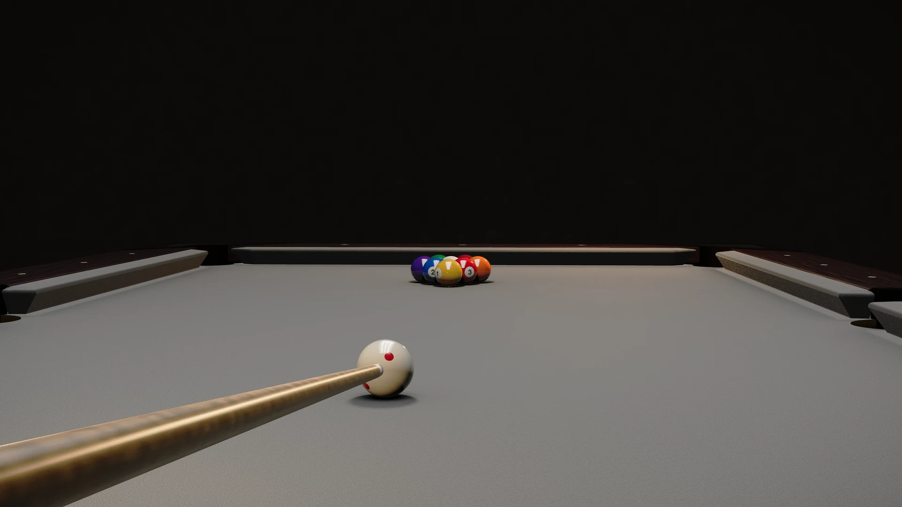

# OpenBilliards

[](https://facebookexperimental.github.io/openbilliards/)

**[Live site](https://facebookexperimental.github.io/openbilliards/)** · **[Play in your browser](https://facebookexperimental.github.io/openbilliards/web/app.html)** · [Hero video](https://facebookexperimental.github.io/openbilliards/assets/img/hero-loop.mp4)

A literature-grade billiards simulator, playable in the browser: full 3D physics
(jump shots, massé, airborne ball–cushion interaction), five disciplines with
rulebook-cited adjudication, bit-exact deterministic replays, and a physics
kernel written in Rust and compiled to WebAssembly.

OpenBilliards was built end-to-end by AI coding agents as an evaluation workload
for agentic software development — and grew into the artifact you are looking at.

## Try it

The canonical WebAssembly kernel is committed, so the game runs from a clean
clone with no build step:

```bash
python3 -m http.server 8000 --directory web
# open http://localhost:8000/app.html
```

## What's inside

- **Physics kernel** (`crates/pool-core`): event-driven analytic simulation —
  closed-form ball motion between events, collision times via ≤ quartic
  polynomial root-finding, three independent cloth-friction regimes,
  velocity-dependent ball–ball throw, endmass squirt, and a parameterized
  cushion impulse model. No general-purpose rigid-body engine: they are
  structurally unfit for billiards.
- **Determinism**: one `.wasm` binary is bit-exact across browsers and
  platforms. Replays and share links carry shot parameters only and
  re-simulate identically, byte for byte.
- **Games & rules**: disciplines are data. The game catalog cites a governing
  body, rulebook edition, and rule sections for every entry; rulesets referee
  kernel event records without re-simulating. Playable today: 9-ball,
  WPA 8-ball, WPBSA snooker, UMB three-cushion carom, and WPA one-pocket.
- **Renderer** (`web/`): Three.js — analytic-sphere soft shadows,
  parallax-corrected reflections, sheen cloth BRDF, replay DVR, video export,
  7-locale i18n.
- **TypeScript SDK** (`sdk/ts`): drive the kernel from web apps; compiled copy
  committed at `web/dist/pool-sdk`.
- **Python bindings** (`crates/pool-py`): thin PyO3 layer over the kernel for
  research and testing.

## Physics provenance

The physics models follow the published literature (Han 2005, Mathavan et
al. 2010, Alciatore's technical proofs, Leckie–Greenspan event simulation)
and measurements documented in `docs/research/`. Parts of the physics
kernel are derived from third-party open-source code under the Apache
License 2.0; `NOTICE` and `THIRD_PARTY_NOTICES.md` identify the upstream
project and list the derived files.

## Building from source

```bash
# Rust kernel + native tests
cargo test --workspace

# WebAssembly artifacts (cargo + wasm-bindgen-cli; see crates/pool-wasm/README.md)
cargo build -p pool-wasm --target wasm32-unknown-unknown --release

# TypeScript SDK
cd sdk/ts && npm install && npm test
```

## Repository layout

| Path | What it is |
|---|---|
| `crates/pool-core` | physics kernel (Rust) |
| `crates/pool-rules` | rules engine (Rust) |
| `crates/pool-wasm`, `crates/pool-rules-wasm` | wasm bindings |
| `crates/pool-cli` | native harness (CI, conformance, regression anchors) |
| `crates/pool-py` | Python bindings (PyO3) |
| `sdk/ts` | TypeScript SDK |
| `web/` | browser game (app + committed canonical wasm) |
| `docs/` | SDK usage docs + physics evidence reports |
| `site/` | project website source |

## Contributing

Development happens in an internal repository; this public repo receives
curated snapshot releases. **Issues are welcome** (bug reports become
evaluation workloads for the agentic pipeline that builds this project);
external pull requests are not merged at this time — see
[CONTRIBUTING.md](CONTRIBUTING.md).

## License

OpenBilliards is [MIT licensed](LICENSE). Parts of the physics kernel are
derived from third-party open-source code and remain under the Apache
License 2.0; [NOTICE](NOTICE) and `THIRD_PARTY_NOTICES.md` identify the
upstream project and list the derived files.

### Third-party dependencies

| Component | License | Where |
|---|---|---|
| [three.js](https://threejs.org) r170 | MIT | `web/vendor/` (license: `LICENSE-three.txt`) |
| [mp4-muxer](https://github.com/Vanilagy/mp4-muxer) 5.2.2 | MIT | `web/vendor/mp4-muxer/` (bundled LICENSE) |
| [webm-muxer](https://github.com/Vanilagy/webm-muxer) 5.1.4 | MIT | `web/vendor/webm-muxer/` (bundled LICENSE) |
| Inter, Space Grotesk fonts | SIL OFL 1.1 | `web/vendor/fonts/` (bundled licenses) |
| Third-party code derived into the physics kernel | Apache-2.0 | [NOTICE](NOTICE), `THIRD_PARTY_NOTICES.md` |
| Rust crates compiled into the wasm binaries | MIT and MIT-compatible | `web/vendor/LICENSE-rust-crates.txt` (generated from `Cargo.lock`) |
| pyo3 (MIT OR Apache-2.0), rust-numpy (BSD) | — | optional Python bindings only |

Vendored third-party code keeps its upstream copyright headers and license
files intact; the full per-file inventory lives in `web/vendor/LICENSES.md`
and [NOTICE](NOTICE).
