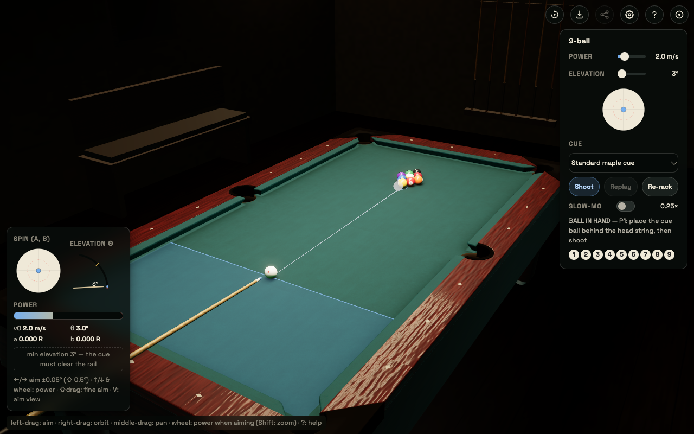
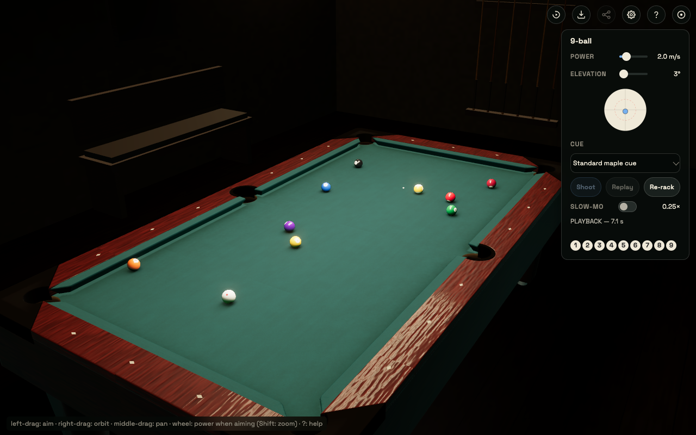
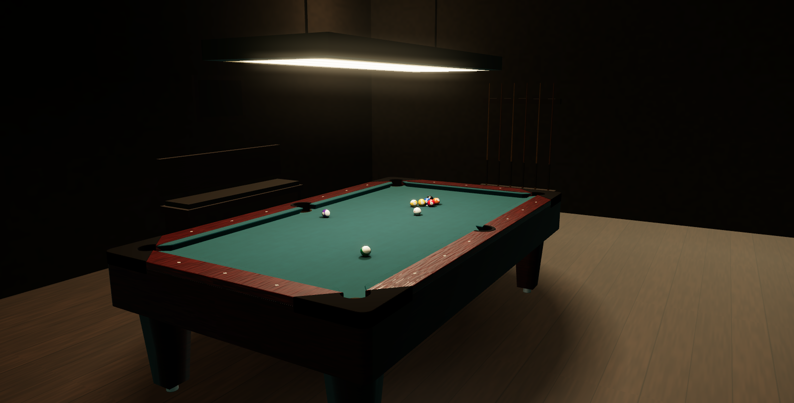
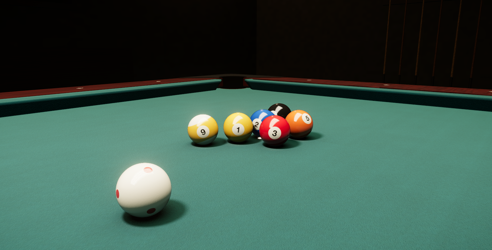

# web/ — playable app + renderer visual-target scene (issues #3, #11 P3/P4)

## Playable 9-ball app (`app.html`, issue #11 P3)

| aim | mid-playback |
| --- | --- |
|  |  |

Run it (ES modules + wasm need an http origin; `file://` is blocked by
Chrome's module/CORS rules):

    python3 -m http.server -d web 8000   # open http://localhost:8000/app.html

Controls: left-drag on the table aims (drag the cue ball itself when you
have ball in hand), right-drag / shift-drag orbits, wheel zooms. HUD: power
0.5–9 m/s, elevation 0–80° (ELEVATION_MAX_DEG in `app/aimwidgets.js`) with a
live GEOMETRIC lower bound — the cue rod must clear the rail tops its
backward line crosses (issue #47: `scene/cuestick.js cueMinElevationDeg`
floors the `#elev` slider per position/azimuth/tip offset; ~39° with the
cue ball frozen on a cushion shooting away) AND every other ball on the
table (issue #64: sphere obstacles — ~40° addressing a ball frozen behind
the cue ball; both checked by
`tools/render/check-cue-clearance.mjs`), cue-ball face widget for tip offset
(contact-true dial, issue #146: full deflection = commanded
0.5·(1+tip_radius/R) R for the EQUIPPED cue = CONTACT offset exactly 0.5 R,
the kernel's cue-aware miscue limit a²+b² ≤ 0.25·(1+tip_radius/R)²,
kernel-api.md Amendment 020 — the dot's screen position is the contact
offset, so the dashed ring keeps its legacy pixels), slow-mo 0.25×,
replay, re-rack.
`?seed=N` picks the rack seed. The gear panel picks EQUIPMENT from the
kernel catalog (issue #15): 台子 table, 台呢 cloth, 球组 ball set, 球杆 cue,
and the advanced 库边模型 cushion model — entries carry calibration badges
(标定 calibrated / 文献 literature / 估计 estimated); changing any re-racks
through the kernel's equipment resolve, and share links (codec v3) carry the
full five-id composition so replays re-simulate on the sender's equipment.
Picking a table also engages its recommended cushion-model pairing (a brand
entry's calibrated bank envelope lives on the paired cushion model — the
catalog's `recommended_cushion_model_id`, applied by the picker, never by
kernel resolve). While a shared replay is active the equipment pickers are
locked — they show the sender's transient spec (sound/assist/camera stay
live).

Physics is the canonical wasm kernel (`web/dist/pool-wasm/`, committed —
rebuild with `scripts/build-canonical-wasm.sh kernel`, the one recipe for
both canonical wasm: plain `cargo build --release` + `wasm-bindgen --target
web` with the cargo home remapped to `/cargo`, then the GH-977 byte gate
`tools/check-wasm-build-paths.mjs`). The app consumes
the kernel through **pool-sdk-ts** (issue #12): `web/dist/pool-sdk/` is the
committed compiled ESM copy of `sdk/ts/` — regenerate with
`cd sdk/ts && npm run build`, never edit by hand. It lives under `web/`
(not `../sdk/ts/dist`) because the served root is `web/`, keeping the
no-bundler http/`file://`-flag workflows intact. Each shot builds a
`ScenarioBuilder` scenario, calls `engine.simulateJson`, and plays the SDK
`Sampler` back in real time (one `sampleAt` per frame into the SDK's reused
`Float64Array`; ball orientation from the sampled quaternions via the
z-up→y-up basis change in `app/coords.js`).

v1 rules (deliberate simplifications): win = 9-ball pocketed on any shot;
the only foul is a scratch (cue ball pocketed → ball in hand behind the
headstring). No wrong-ball-first / no-rail / three-foul rules, no push-out,
and no 9-ball respot.

Headless e2e (produced the committed screenshots; needs node ≥ 22 and the
PINNED chrome-headless-shell — GH-294: the harness never boots the installed
Chrome app headlessly, because such boots register with LaunchServices under
com.google.Chrome and hijack the Dock icon. One-time install, version from
`web/tools/chrome-shell.pin`:

    npx @puppeteer/browsers install \
      chrome-headless-shell@$(cat web/tools/chrome-shell.pin) \
      --path "$HOME/.cache/puppeteer"

`CHROME_BIN` still overrides for CI images and wrapper-script fallbacks;
`headless:false` sessions (perf-aim `--headed`) keep the installed app —
the shell cannot present a real window):

    node web/tools/e2e.mjs
    node web/tools/e2e-userboot.mjs   # REAL-USER boot gate: plain app.html
                                      # (no obtool stamp) must render the tournament
                                      # look, survive a poisoned module cache
                                      # (app.html boot-guard self-heal), and
                                      # keep the scripted green/cinema pin.
                                      # REQUIRED for any boot or look change —
                                      # the scripted suites all boot stamped
                                      # and cannot see user-path regressions
                                      # (the 2026-07 black-page incident)
    node web/tools/e2e-equipment.mjs  # Equipment pickers gate: worn cloth
                                      # lags shorter, the low-deflection cue
                                      # squirts less, snooker balls re-rack
                                      # at their radius (issue #15)
    node web/tools/e2e-lighting.mjs   # lighting axis gate (issue #89):
                                      # scripted identity rig pin (canopy
                                      # 7.6/0xfff1da, exposure 1.05±1e-9),
                                      # fixture/brightness settings round
                                      # trip + reload persistence, per-
                                      # fixture emitter/parallax/bake-
                                      # honesty smoke, 520-lux WPA detent
                                      # snap, brightness never touches
                                      # toneMappingExposure, per-key boot
                                      # overrides, stale-lightingvisuals
                                      # degrade → canopy GI re-pin
    node web/tools/e2e-i18n.mjs       # i18n gate: orphan-literal lint, per-
                                      # locale dictionary audit (0 missing/
                                      # extra vs en), live language switch
                                      # across HUD/settings/export dialog,
                                      # zh-CN foul banner, persistence
    node web/tools/e2e-rollslip.mjs   # roll-slip gate (050): rendered rolling
                                      # constraint (contact-point slip ~ 0),
                                      # incl. the endpoint-blind english
                                      # fixture (spin clamps before h/4) and
                                      # the rolling-english twist laws (#179
                                      # spinning handoff, #297 english-to-
                                      # cushion + mid-leg clamp plateau)
    node web/tools/test-rollcorrect.mjs # rollcorrect module gate (#297, no
                                      # browser): twist + clamp laws plus the
                                      # record shapes the browser can't stage
                                      # (pocket close, compliant rack close,
                                      # rest-seat snapped close), #179
                                      # isolation, seek determinism
    node web/tools/test-sinkpivot.mjs # lip-pivot sink unit gate (#236, no
                                      # browser): blend law, seek purity,
                                      # spin preservation, cup containment
    node web/tools/e2e-touch.mjs      # touch gate (014): phone emulation
                                      # (setDeviceMetricsOverride 844x390
                                      # DPR3 mobile + setTouchEmulation-
                                      # Enabled BEFORE boot) — classifier
                                      # laws, gauge/spin/nudge parity,
                                      # explicit-fire-only, rotate prompt,
                                      # tap-to-aim quick aim (issue #46:
                                      # object-ball tap lands the cue on
                                      # the ball-center azimuth bit-exact,
                                      # camera bit-unchanged);
                                      # --scenario fullrack = scripted
                                      # 8-ball rack start-to-win by touch;
                                      # --desktop-inert = fine-pointer boot
                                      # stays byte-inert (zero touch-module
                                      # requests).
    node web/tools/e2e-touch-disciplines.mjs
                                      # US3 disciplines gate (014 T031-T035,
                                      # SC-004): snooker D placement by
                                      # touch drag, carom break-spot
                                      # decision + start-spot snap, 8-ball/
                                      # one-pocket nomination (marker taps
                                      # + pocket-picker sheet + safety),
                                      # decision prompts >=44pt x7 locales
                                      # at 844x390 AND 667x375.
    node web/tools/e2e-drills.mjs     # practice-mode gate (issue #66): four
                                      # drills end-to-end through the
                                      # window.__drills seam — published
                                      # base-seed re-derivation (SHA-256
                                      # audit-on-load law), byte-identical
                                      # layouts across boots, BU ladder
                                      # advance/retreat, station scoring
                                      # with an in-test record/judgment
                                      # recomputation (objective honesty),
                                      # circle containment + run end,
                                      # cushion-whitelist violation, ghost
                                      # rack loss + seeded re-rack,
                                      # ob-drills-v1 persistence across a
                                      # reload, virgin-boot hermeticity,
                                      # stale-kit inert degradation; snake
                                      # arms (issue #80): the snooker
                                      # discipline pin + SNOOKER_LAYOUT
                                      # spot exactness + the in-hand-in-
                                      # the-D grant, the in-order yellow
                                      # pot (stays down, R3(h)(ii)) vs the
                                      # out-of-order green foul (respots
                                      # on its own spot), the black-
                                      # terminal WIN-window banner
                                      # survival, snooker-context
                                      # teardown, the snake-lateral
                                      # layout probe, stale-layouts
                                      # refusal (pool drills unaffected,
                                      # pre-pin session mode restored),
                                      # the immediate-tap start under a
                                      # held-slow layouts leaf,
                                      # picker truncation x7 locales
    node web/tools/e2e-straightpool.mjs
                                      # 14.1 continuous gate (025, issue
                                      # #65): WPA Sec. 7 through the real
                                      # app — the 7.3(b) breaking-violation
                                      # loop (decision 11 accept/re-break,
                                      # repeatable, −2 carries), full call
                                      # regime +1/ball with run
                                      # continuation, 7.9 fouls (−1,
                                      # cue-stays vs kitchen scratch), the
                                      # 14-at-14 judged-form PARTIAL
                                      # re-rack + the 7.8 Table 1
                                      # interference chart (head spot /
                                      # kitchen / full-15) + in-app Replay
                                      # re-derivation, 7.11 three-foul
                                      # (−15 + full re-rack + mandatory
                                      # re-break), 7.4 race-to-target win,
                                      # HUD scoreboard + hook wire
    node web/tools/e2e-playground.mjs # mode system + playground gate (issue
                                      # #68): virgin-boot play default, the
                                      # settings mode selector (3 radios,
                                      # per-mode blocks, drills row under
                                      # Practice), play->playground keeps
                                      # the table, mode persistence across
                                      # a reload, placeBall exactness +
                                      # overlap nudge (#44 law), REAL mouse
                                      # drag of an object ball, the
                                      # no-judgment invariant (9-pot +
                                      # scratch: zero foul/win/turn
                                      # mirrors, cue respot), single-slot
                                      # undo + grab-abort undo integrity,
                                      # one re-rack affordance in
                                      # playground (HUD button hidden),
                                      # shift stays fine aim in the
                                      # sandbox, playground->play fresh
                                      # rack + HUD Re-rack restore,
                                      # Practice hand-off to the drill
                                      # picker, mode<->drill agreement
                                      # (drill dies leaving practice /
                                      # start pins practice), touch S3
                                      # drag-any-ball
    node web/tools/e2e-aimwarn.mjs    # pre-shot wrong-ball warning gate
                                      # (issue #88): the warn-tone chip
                                      # fires IFF the aim preview's
                                      # predicted first contact is an
                                      # illegal first target under the
                                      # active rules projection — 9-ball
                                      # non-lowest, 8-ball wrong group /
                                      # the 8 (open-table + openClaim
                                      # nuances), snooker ball-on incl.
                                      # nominated-colour correctness +
                                      # unarmed-phase suppression; the
                                      # DOCTRINE PIN (predicted scratch
                                      # with a legal first ball → NO
                                      # chip, proven by the fired
                                      # record's cue BallPocket); toggle
                                      # round-trip, assists-off gate,
                                      # playground never, #71 passive-
                                      # chrome laws; stale-preview flash
                                      # pin (a fired shot's prediction
                                      # never leaks into the next aim —
                                      # rAF-granularity in-page probe)
    node web/tools/e2e-settings.mjs   # settings-modal gate (015): modal
                                      # open/close + six-section registry,
                                      # decision-pending gear lock, kit
                                      # confirm both branches + ZERO
                                      # window.confirm/alert probe, pre-015
                                      # persistence fixture compare,
                                      # reduced-motion arm, phone sheet at
                                      # 844x390/667x375, stale-navmodal
                                      # degradation arm
    node web/tools/e2e-bugreport.mjs  # bug-report gate (025 + Amendment
                                      # v2): Settings → About "Report bug"
                                      # row (localized, never truncated),
                                      # schema-v3 bundle download (blob
                                      # anchor; content via in-page hook —
                                      # bundle_version 3 / kernel + rules
                                      # stamps / scenarios / judgments
                                      # ledger with the pinned
                                      # {rack, seed, shot} anchor / balls /
                                      # replay link), judge-broken ledger
                                      # row ({…, judgeError} via the
                                      # failNextJudge seam), broken-
                                      # provider + broken-judgments
                                      # resilience ({error} section, bundle
                                      # still downloads), zero non-origin
                                      # requests. Triage captured bundles
                                      # with tools/analyze-bugreport.mjs
                                      # (playbook: the bug-report
                                      # triage guide, internal)
    node web/tools/e2e-archive.mjs    # session-archive gate (030 Phase A,
                                      # issue #225; ports 8307 / CDP 9601):
                                      # hermetic scripted boot writes ZERO
                                      # IndexedDB, ?archive=1 opt-in arms;
                                      # split/segment semantics incl. the
                                      # judged eightball-v2 re_break
                                      # mid-settle re-rack (segment opens
                                      # at the first post-re-rack shot);
                                      # playground + drill sessions (one
                                      # session per drill run), reload
                                      # survival byte-identical, replay
                                      # exclusion, retention caps
    node web/tools/e2e-playback.mjs   # Playback DVR UI gate (030 Phase C,
                                      # issue #225; ports 8311 / CDP 9611):
                                      # empty state, session list rows +
                                      # marker glyph strips + filters,
                                      # player scrub stages the correct
                                      # shot/segment-local time over the
                                      # live bed, trim+camera+speed produce
                                      # the exact renderDrill timeline args
                                      # (stubbed __export seam, no full
                                      # render), capability-aware
                                      # destination routing (web vs
                                      # injected shell bridges), per-row
                                      # delete via kit confirm, close
                                      # restores the live table (no
                                      # archived duplicates), stale
                                      # playback.js/export.js degradation.
                                      # CONFIRM-FIRST save (owner fix wave):
                                      # opening the card renders NOTHING —
                                      # arm 3 asserts zero renderDrill calls
                                      # before the Export CTA is pressed,
                                      # arm 3d gates the WYSIWYG invariant
                                      # (setup changes free, settled blob
                                      # invalidated, picker locked mid-
                                      # render) and arm 8 gates the card /
                                      # list STRUCTURE on a coarse 852x393
                                      # phone boot: pinned head with an
                                      # elementFromPoint hit-test on the X
                                      # after scrolling to the bottom, kit
                                      # combobox + popover option hit-tests
                                      # inside the modal, no native chrome
    node web/tools/e2e-haptics.mjs --inert
                                      # iOS shell haptics inertness (016,
                                      # SC-004): desktop AND emulated-
                                      # coarse boots WITHOUT the obHaptics
                                      # bridge issue ZERO network requests
                                      # for app/haptics.js, zero DOM
                                      # deltas, zero console output —
                                      # plus a forced-load defense-in-
                                      # depth arm (inert stub, registers
                                      # nothing)
    node web/tools/e2e-haptics.mjs --seam
                                      # bridge seam gate (016, SC-005):
                                      # pre-boot mock obHaptics collector;
                                      # collected messages must equal
                                      # deriveCues(record) post-
                                      # coalescing, 1:1 in class +
                                      # clamped gain; rewind/throwing-
                                      # bridge laws included
    node web/tools/render/check-cue-clearance.mjs
                                      # cue-geometry unit fixture (issues
                                      # #47 + #57 + #64): geometric minimum
                                      # elevation — hand-computed frozen-
                                      # rail case, zero branch (oversized /
                                      # 12-ft long axis), monotone decay
                                      # off the rail, tip-offset shifts,
                                      # per-catalog-entry sweep — plus the
                                      # #57 reachability envelope: deep-
                                      # draw kernel-mirror pin 56.47°,
                                      # empty RAIL dead set at the shipped
                                      # 80° cap, dead cells + exact
                                      # boundary clamp under a 40° probe
                                      # cap, grid-vs-direct consistency,
                                      # center-table full disc, jaws
                                      # solid-band case — plus the #64
                                      # ball-obstacle matrix: frozen-to-
                                      # ball 40.35° / 2.2R-gap 18.16°
                                      # kernel-mirror pins vs an
                                      # independent tangency solve,
                                      # graze/in-front/beyond-reach edges,
                                      # multi-ball + rail max composition,
                                      # carve-corridor balls, tip-offset
                                      # monotonicity with an obstacle,
                                      # discipline radii, memo-sig
                                      # invalidation on ball moves (plain
                                      # node, committed three stub)
    node web/tools/e2e-harness-hygiene.mjs
                                      # harness red-proof gate (GH-294):
                                      # pinned-shell resolution + fail-fast
                                      # install error, LaunchServices non-
                                      # registration (--red boots the
                                      # installed app once to prove the
                                      # probe sees com.google.Chrome),
                                      # zero leftover profile dirs/child
                                      # pids on closeAndWait/close/launch-
                                      # failure paths, startup self-sweep
                                      # reaps a planted aged orphan and
                                      # spares a fresh foreign-port dir —
                                      # plus the GH-248 wedge arm: a
                                      # SIGSTOPped (alive, unresponsive)
                                      # browser trips the liveness verdict,
                                      # the rejection carries the cdpWedged
                                      # boot-loss marker (scenario-render's
                                      # checkpoint/resume input), and the
                                      # kill path reaps the stopped child

## Showcase video production (issue #154)

`web/tools/showcase-render.mjs` produces the hero showcase video through the
issue-#154 render hooks (`__test.loadRecord` + `__test.cameraScript` +
`__test.renderQuality`): five physically validated shots — massé hook,
75° boomerang (grounded pinch, full draw at the commanded miscue cap), the
owner's reference drag shot (1.5 diamonds / 10° cut / 160.7° separation),
the slow-motion reference jump-draw, and a 9-ball break — are simulated on the COMMITTED
canonical wasm in node, gated by event assertions (`sim`), framestep-rendered
at 2560×1440 in 2-3 scripted camera passes each (real-time establish +
8-32× super-slow-motion + overheads; the kernel samples any dt, so slow
motion is true physics), and assembled with ffmpeg into a 30 fps master cut
(PIL text strips; this build's ffmpeg has no drawtext):

    node web/tools/showcase-render.mjs sim        # gate all five shot sims
    node web/tools/showcase-render.mjs verify     # determinism ×2 (fresh boots)
    node web/tools/showcase-render.mjs render     # all passes (~2300 frames)
    node web/tools/showcase-render.mjs assemble   # labels + master mp4
    node web/tools/showcase-render.mjs stills     # contact sheet

Ports follow the render-hooks-demo convention (`--port` / `OB_E2E_PORT`,
default 21550; CDP at port−21540+26330 — offset +40 so parallel lanes' Chromes can't be
hijacked; the session hard-checks the page origin). Media stays out of the
repo (deliverables go to the owner's Drive).

## Venom reproduction renders (issue #154 W3)

`web/tools/venom-render.mjs` (showcase-render structure) renders the three
strongest Venom trick-shot reproductions as site-grade clips. Scenarios are
NOT re-tuned: the fit records' best-fit parameters + extraction
layouts (internal records, not in this repository)
are re-simulated on the committed canonical wasm through the exact fit.py
input mapping (record→kernel rotation, contact-offset clamp + commanded
scaling, cloth trio, cue mass options, CompliantChain pin), and `sim` gates
every clip against the fit records' own S-side observables (pot events,
flight/hop windows, arc shape). Shots: the 88.6° vertical massé jump
(shot 4, PARTIAL), the table-length massé around a 9-ball line (shot 3,
PARTIAL), and the fouetté-follow CB story (shot 2 — CB side reproduces at
1–2σ; the orange's airborne cushion launch is the ledgered kernel gap and
stays out of frame). Rendering uses the SITE look per
`docs/site-assets/img-SOURCES.md`: `?look=tournament&table=diamond_proam_9ft` boot pins
+ the tournament steel-gray cloth variant re-applied on the branded Diamond through
`clothvisuals.js` (applyLook keeps factory cloth on branded tables), 2560×1440
crf-12 masters, and `grade` produces 1080p site-candidate cuts through the
committed film curve (`tools/render/grade.json`) + vignette + grain:

    node web/tools/venom-render.mjs sim      # gate all 3 sims (fit parity)
    node web/tools/venom-render.mjs render   # all passes (~1600 frames)
    node web/tools/venom-render.mjs verify   # determinism ×2 (fresh boots)
    node web/tools/venom-render.mjs grade    # 1080p site-candidate cuts
    node web/tools/venom-render.mjs stills   # contact sheet

Ports: `--port` / `OB_E2E_PORT` (default 21642), CDP at port−21630+16551 — a
band of its own so showcase/e2e lanes can't be hijacked. Media stays out of
the repo (deliverables go to the owner's Drive under `openbilliards/venom/
repro/`).

The UI ships in 7 languages (en default; zh-CN/es/ja/de/fr/ko via Settings →
Language, persisted; fresh profiles follow `navigator.language`). All
user-facing strings live in `web/app/locales/<locale>.json` (flat key →
template; en is the source of truth) served by `web/app/i18n.js`
(`t(key, params)`, live `setLocale`, `data-i18n` DOM slots). Rules fouls
reach the HUD as SDK `judgment.fouls` CODES translated at the presentation
boundary (`web/app/flow.js`); equipment pickers translate catalog ids via
`equipment.<id>` keys, falling back to the kernel's English `display_name`
for ids the dictionaries do not know yet.

zh-CN copy conventions (GH-437; `zh`/`zh-TW` resolve to zh-CN, so this is
the one Chinese dictionary): punctuation inside Chinese prose is
FULL-WIDTH — ，：；（）？！ — including parentheses whose content is Latin
(（LD 杆）,（57.15 mm）). ASCII stays only for tokens that are not prose
punctuation: unit/number tokens ("18.5 MB", decimal points, dates),
numeric ratios ("1:1"), the spin tuple "(a, b)", key names ("?" as a
keyboard key), and rule-cite INNER letter parens — the cite itself takes
full-width outer parens with ASCII inner letters:（WPA 4.3(g),(h)）. The
persona is always 玩家 {player} (never the compact `P{n}` that other
locales use for chips); new zh-CN keys follow both rules.

Pointer-register copy (GH-463): instruction strings that name the user's
GESTURE ("click/tap a pocket") carry a `<key>.mouse` variant (fine-pointer
wording) and a `<key>.touch` variant (touch wording) in every locale; the
BASE key keeps the legacy copy byte-for-byte, because stale pre-463
modules keep reading it against a fresh dictionary (the mixed-cache
degrade law — review r2; most legacy strings already spoke the touch
register, so their `.touch` variant repeats the base bytes — zh-CN's
call.* hints are the exception that motivated the explicit variant).
Fresh consumers resolve the trio through `i18n.js tp(key, params)`
(feature-detected via a namespace import — OWNERSHIP rule 5), which reads
the app's own input-grammar signals (`window.__touch.installed` /
`html.ob-touch`) at every call; i18n.js itself observes `html.ob-touch`
and re-fires the locale subscribers on a register flip (fresh-side seam —
review r4: a cached pre-463 touch leaf still installs the grammar but
cannot call in), so hints painted before the touch leaf lands repaint in
the right register. Verb pairs mirror the help overlay's per-register
convention (`help.controls.mouse.*` vs `help.controls.touch.*`):
en click/tap, de anklicken/antippen, es haz clic/toca, fr cliquez/touchez,
ja クリック/タップ, ko 클릭/탭, zh-CN 点击/点按. Register-neutral phrasing
needs no variant — prefer it where the gesture need not be named.

It loads the app, runs a scripted break, a deterministic corner-pocket
scratch (ball-in-hand flow) and a seed-4 nine-ball-on-the-break WIN flow,
screenshots AIM / mid-PLAYBACK / settled, fails on any console error, and
reports frame times (headless on this machine: composer.render p95 0.6 ms;
RAF-delta p95 ~27 ms is headless compositor scheduling, not render cost).

## Renderer visual-target scene (`spike.html`, issues #3, #11 P4)

`spike.html` is a self-contained, offline Three.js scene: a full WPA 9-ft
table (geometry mirrored from `crates/pool-core/src/table.rs::wpa_9ft`) with
procedurally textured balls, in a dim pool-hall room under a hanging light
box. It is both the visual-quality testbed for issue #3 and the seed of the
future app's render layer.

| full table (`?view=full`, default) | close-up (`?view=closeup`) |
| --- | --- |
|  |  |

## Module layout (consumed by the future app)

- `scene/shading.js` — shared shader injection: analytic sphere soft
  shadows/AO (Inigo Quilez closed forms; **no shadow maps anywhere**),
  box-projected (parallax-corrected) cubemap sampling + shader-level
  ray-sphere ball-ball inter-reflection; seeded rng + tileable noise helpers.
- `scene/table.js` — cloth bed with pocket cutouts + markings (foot spot,
  18 pearl diamond sights), six cushion rails extruded from the *kernel's*
  cushion polygons (straight-chord jaw approximation of the K-66 profile),
  wood frame ring/apron/legs, six pockets with dark throats and leather rims.
  Playing surface is exactly 2.54 x 1.27 m nose-to-nose, cushion width
  0.0508 m, pocket centers/radii identical to `Table::wpa_9ft`.
- `scene/balls.js` — procedural ball textures (numbers/stripes/measles/wear),
  phenolic `MeshPhysicalMaterial`, fills the shared analytic-sphere uniforms.
- `scene/room.js` — plank floor, dim textured walls, hanging light box with
  emissive tube-diffuser face (what ball crowns reflect), unlit wall-side
  props (cue rack / bench / scoreboard plaque behind the `obFarPropTable`
  legacy carrier), the LTC `RectAreaLight`, and the parallax box for
  reflections.
- `scene/postfx.js` — MSAA half-float composer: bloom + gentle pre-tonemap
  exposure falloff (replaces the old hard vignette) + ACES output.
- `spike.html` — importmap + composition + startup cubemap bake + frame loop.

## Techniques (issue #3 checklist)

- **Parallax-corrected (box-projected) cubemap** ball reflections; the room
  (table + light box + walls, balls hidden) is baked once at startup into a
  cube render target from the parallax-box center, so the emissive lamp face
  anchors correctly on ball crowns.
- **Analytic sphere soft shadows + AO** in the cloth/cushion shaders over up
  to 16 sphere uniforms. Balls on cloth need no shadow maps; rails/frame use
  the same injected shadows plus hemispheric ambient. The table's shadow on
  the floor is a baked-look gradient blob (RectAreaLights cannot cast).
- **Ball-ball inter-reflection**: each ball's env lookup ray-sphere intersects
  the other balls and blends their shaded color + a light-box glint.
- **Cloth BRDF**: sheen + anisotropy aligned with the table length +
  directional nap normal map + mottle/hue-variation/brush-band color map.
- **LTC RectAreaLight** light box; ACESFilmic tone mapping, UnrealBloom,
  gentle exposure falloff through an 8x MSAA half-float composer chain.
- **Baked GI (app only)**: `tools/render/bake-lightmap.mjs` — a deterministic
  zero-dep path tracer over an analytic mirror of the static scene — bakes
  plan/flank lightmaps (lamp-visibility alpha → cushion-nose shadow bands +
  pocket-mouth darkening; sqrt-encoded 1-bounce irradiance → cloth bounce on
  rail flanks), a floor map (lamp pool + real table shadow, consumed through
  the floor material's lightMap channel + the shadow-blob overlay) and an
  SH-L2 irradiance probe grid at ball height (per-ball local ambient — green
  underside tint near cloth, lamp-side warmth — additive to the cubemap
  specular). Committed under `web/assets/gi/` with a manifest (scene hash,
  seed, sample counts); two full bakes are byte-identical. Runtime loader:
  `scene/gi.js`; feature flag `?nogi` restores pre-GI lighting. Cloth visual
  variants (`scene/clothvisuals.js`) key the steel-gray tournament cloth to
  the catalog's `simonis_860_tournament`; `--look tournament` selects it.
- All textures canvas-procedural, all randomness seeded — reproducible frames,
  no binary assets beyond the committed screenshots and the GI bake.

## Running

Chrome blocks ES-module imports from `file://` origins, so either serve it:

    python3 -m http.server -d web 8000   # open http://localhost:8000/spike.html

or open straight from disk with the flag:

    "Google Chrome" --allow-file-access-from-files web/spike.html

Headless verification (what produced the committed screenshots):

    "/Applications/Google Chrome.app/Contents/MacOS/Google Chrome" \
      --headless=new --allow-file-access-from-files --disable-extensions \
      --screenshot=web/spike-preview.png --window-size=1600,900 \
      --virtual-time-budget=10000 "file://$PWD/web/spike.html?view=full"

(`?view=closeup` for the close-up; `?view=top` is a top-down geometry-debug
camera for eyeballing rail/pocket layout against the kernel.)

## Tournament-look scenario videos (`tools/record.mjs --look tournament`)

Every slow-motion reference catalog scenario (catalogued under
the internal verification records) renders as a broadcast-demo-style clip: `scene/look.js`
regrades the scene (gray cloth, mahogany rails, near-black room; the
interactive default look is untouched), `tools/cameras/<key>.json` holds the
per-scenario reference-matched camera (kernel-frame `cam`/`look`/`fov` plus
mid-clip `cuts` at kernel playback times), and the title card mirrors the reference's
lower-left caption style with our own openbilliards wordmark:

    node web/tools/record.mjs --out /tmp/backspin.mp4 --preset backspin \
        --framestep --slowmo 0.1 --look tournament

Scenario presets auto-load their camera spec; pass `--camera <file.json>`
to override it.

## In-app video export (`app/export.js`)

**Export video…** (next to Record) re-renders the LAST SHOT offline at a
picked quality tier — deterministic frame-stepped replay of the ShotRecord
(the same `app/framestep.js` timeline `record.mjs --framestep` uses), so
export quality is independent of gameplay frame rate and canvas size.
Tiers per the ruling in `the video-export design note (internal)`:

| tier | knobs | output |
|---|---|---|
| Realtime | live MediaRecorder capture of the replay (`app/record.js`) | webm, any browser |
| Standard | shutter 1, grade | 720p/1080p mp4 |
| High | ssaa 1.5, shutter 8, grade, DOF | 720p/1080p mp4 |
| Ultra 4K | shutter 4, grade, DOF | 1440p/2160p mp4 |
| Cinema 4K | shutter 16, grade, DOF — slow, best | 2160p mp4 |

Offline tiers render through the cinema accumulator
(`scene/postfx.js createAccumulator` via `__test.renderAccum`), apply the
`tools/render/grade.json` curve+vignette as a shader pass (single-sourced
with the node pipeline through the `web/tools/render` symlink), grab frames
with `new VideoFrame(canvas)` and encode via WebCodecs into an in-page
muxer (`vendor/mp4-muxer` avc1+AAC; `vendor/webm-muxer` VP9+opus when
H.264/AAC is unavailable; no WebCodecs at all → Realtime tier only). Audio
is the record's cue list re-voiced through the shared seeded synth
(`app/synth.js`) in an OfflineAudioContext (`app/export-audio.js`). The
dialog's ETAs come from the committed benchmark model scaled by a 10-frame
probe on the local machine; progress is exact (deterministic frame count)
and Cancel aborts cleanly with no partial file. Same record + tier +
resolution ⇒ identical pre-encode frame hashes (`node
web/tools/e2e-export.mjs` gates this, plus the dialog flow, cancel, and
the no-WebCodecs fallback).

## Vendored dependencies

three.js 0.170.0 module build + jsm addons live in `vendor/` (MIT — see
`vendor/LICENSES.md`), imported via importmap so the page needs no network.
`vendor/mp4-muxer` 5.2.2 + `vendor/webm-muxer` 5.1.4 (MIT) mux the
WebCodecs export in-page.
